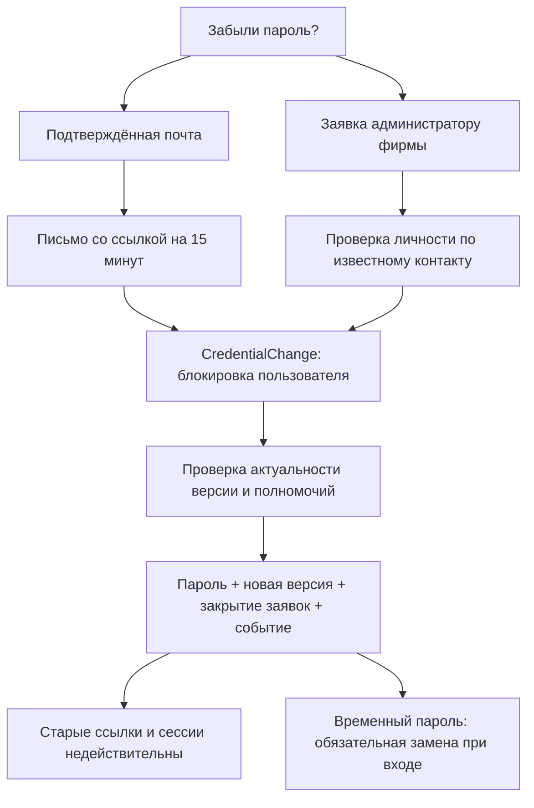

# Управление доступом и восстановление пароля

Реализовано в ветке `feature/company-access` от main после PR #19. Коммиты и PR выполняются совместно с Владом.

## Границы ответственности

- Контроллеры принимают HTTP, выбирают записи внутри текущей организации и возвращают ответ.
- Pundit-политики в `app/policies` определяют полномочия администратора и права на конкретный склад.
- `CredentialChange` объединяет смену пароля, отзыв восстановления и запись события в одну транзакцию с блокировкой строки пользователя.
- `MembershipChange` меняет только выбранное назначение. При одобрении активирует ожидающего пользователя; блокировку пользователя не снимает.
- Ограничения БД защищают принадлежность заявки/события фирме и запрещают две ожидающие заявки на одного пользователя.

## Восстановление

`POST /password_recovery` принимает `recovery: {email_address, channel: email|admin}`. Ответ всегда 202 с одинаковым сообщением для существующей и неизвестной почты. Само обращение не блокирует аккаунт. Rails rate_limit ограничивает IP и адрес. Проверка владения почтой, актуальности версии и создание заявки выполняются в фоновой задаче. Неподтверждённая почта не получает ссылку. Администраторы восстанавливаются через свою почту или отдельное серверное вмешательство владельца приложения: пользовательский поток помощи не позволяет сбрасывать администратора.

`credentials_version` хранится у пользователя и в сессии. При смене password_digest, почты или блокировке пользователя версия увеличивается. Изменение почты сбрасывает подтверждение. Старые cookie-сессии без версии требуют повторного входа после установки этой версии приложения.

Ссылка восстановления — подписанный Rails-токен `account_recovery`, связанный с версией, адресом и состоянием подтверждения. В токене нет пароля. Нажатие GET не меняет пароль; POST заново проверяет токен внутри блокировки. Два одновременных восстановления сериализуются на одной строке: первый успешный запрос увеличивает версию, второй получает конфликт. При ошибке валидации ни версия, ни заявка, ни журнал не меняются.

Заявка админу действует сутки. Состояния: pending/completed/rejected/superseded. Повторное обращение возвращает общий ответ и не создаёт второй pending. Истёкшая или устаревшая заявка не может изменить пароль; при новом обращении она закрывается. Администратор задаёт временный пароль, подтверждает проверку личности и передаёт его лично/по известному каналу. Новый пароль не отправляется письмом. Следующий вход даёт только профиль, выход и замену пароля; доступ к рабочим операциям закрыт до замены. Простой флажок проверки личности не заменяет реальную организационную процедуру.

`PATCH /password` требует текущий пароль и два совпадающих новых значения. Пароль не короче 8 символов и отличается от текущего. После смены нужен обычный вход. Статусы pending/blocked и назначения не изменяются. На подтверждённый адрес после commit ставится уведомление без пароля.

## Компании и склады

`OrganizationOnboarding` создаёт организацию с уникальным стабильным `code`, первый склад и активного администратора с обязательной заменой начального пароля. `code` — внутренний идентификатор подключения, не ИНН. Он необязателен для исторических организаций. Повтор с тем же кодом проверяет основные данные и ничего не меняет; другая почта/фирма вызывает конфликт. Пользователь с уже занятой почтой не переносится и не становится администратором автоматически.

Команда: `bin/rails warehouse:onboard`. Требует переменные окружения:

- WAREHOUSE_ORGANIZATION_CODE, WAREHOUSE_ORGANIZATION_NAME
- WAREHOUSE_ORGANIZATION_LEGAL_FORM: ooo или ip
- WAREHOUSE_NAME
- WAREHOUSE_ADMIN_NAME, WAREHOUSE_ADMIN_EMAIL
- WAREHOUSE_ADMIN_PASSWORD (для первого запуска; повтор не меняет пароль)

Пароль передавать через защищённое окружение, без записи в git и историю команд. `db:seed` использует тот же сервис. Команда не заполняет фиктивные фирмы и не присваивает существующим людям новые роли.

Администратор может создавать и переименовывать склады своей фирмы. Новый склад получает нулевые остатки для существующего каталога, сотрудников на него назначают отдельно. Создание товара сразу для всех складов и пересылка материалов между ними — отдельный этап складского учёта, в эту задачу не входят.

## Полномочия

| Роль | Область |
|---|---|
| Администратор организации | Сотрудники, склады, назначения и восстановление обычных сотрудников только своей фирмы |
| Управляющий складом | Рабочие операции своего склада, отдельная политика manage? для последующего согласования перемещений |
| Оператор | Рабочие операции на складах с активным назначением |

Глобальная блокировка перекрывает все назначения. Администратор не может заблокировать другого администратора или сбросить ему пароль через пользовательскую панель. Изменение роли admin через API назначений отсутствует: допускаются только operator/warehouse_manager. Учётная запись и назначение имеют отдельные статусы. Старый endpoint activate требует membership_id при нескольких ожидающих назначениях; при одном сохраняет совместимость. Массовое одобрение всех назначений удалено.

Новые API административной части: `/admin/warehouses`, `/admin/warehouse_memberships`, `/admin/password_recovery_requests`, `/admin/access_events`. Все выборки ограничены организацией сессии. Чужие идентификаторы дают 404. Основные новые действия фиксируются в журнале: смена пароля, отклонение восстановления, назначение, блокировка/разблокировка, создание/переименование склада. Старые действия до миграции не восстанавливаются задним числом.

## Поиск и индексы

- `/admin/users?q=`: точная нормализованная почта, числовой ID или начало имени. Фильтр статуса и ограниченная страница сохраняются.
- Уникальный индекс почты уже существовал. Добавлены (organization_id,status,id) и (organization_id,lower(name) text_pattern_ops).
- Журнал доступа использует пагинацию по последней паре (created_at,id), без глубокого OFFSET. Индексы поддерживают ленту фирмы и фильтр user_id.
- Для будущего журнала движения добавлен (organization_id,user_id,created_at,id); сам экран складского журнала — следующий этап.
- Это не нагрузочная сертификация. Индексы следует оценивать EXPLAIN ANALYZE на реальном распределении данных, а не считать гарантом любого времени ответа.

## Запуск и границы проверки

После `bundle install`: `bin/rails db:migrate`, затем `npm --prefix frontend ci` и `npm --prefix frontend run build`.

Локальный SMTP — Mailpit (1025, интерфейс 8025). В development фоновая очередь по умолчанию живёт в процессе Rails; остановка процесса может потерять ещё не выполненные задачи. Production использует Solid Queue: должны быть подготовлены его БД и запущен `bin/jobs`. Ошибки подключения SMTP в PasswordRecoveryJob повторяются до 5 раз.

Для production задать WAREHOUSE_PUBLIC_HOST, WAREHOUSE_MAIL_FROM и WAREHOUSE_SMTP_ADDRESS/PORT/USERNAME/PASSWORD. Ссылки production используют HTTPS и настроенный host, не Host входящего запроса. Реальная доставка внешним получателям, DNS/SPF/DKIM и production-развёртывание не проверены. Ограничение частоты в development локальное (memory cache), в production опирается на общий Solid Cache.

Проверки: полный Rails suite, тест конкурентного восстановления на двух подключениях PostgreSQL, ограничения БД, сборка React, RuboCop, Brakeman, аудит зависимостей. В браузере проверены запрос письма через SMTP/Mailpit, ограниченный экран временного пароля, список сотрудников, сохранение назначения, создание склада и отображение событий. Полный набор браузерных регрессионных тестов пока не автоматизирован.

## Результат проверки 15.11.2026

- `bin/rails test`: 115 tests, 570 assertions, 0 failures, 0 errors.
- `bin/rubocop`: 101 files inspected, no offenses.
- `bin/brakeman --no-pager --quiet`: 0 security warnings.
- `bin/bundler-audit check --update`: no vulnerabilities found.
- `bin/rails zeitwerk:check`: загрузка приложения успешна; Rails отдельно отмечает preview-каталог почты вне eager_load.
- `npm --prefix frontend run build`: успешно. Vite сообщает об игнорировании директивы use client в lucide-react; сборка завершена.
- QA-организация, сотрудники, назначения и записи журнала после браузерной проверки удалены из development; временный сервер 3001 остановлен.
- Production SMTP, production Docker image и нагрузочный прогон этой итерации не выполнялись.
